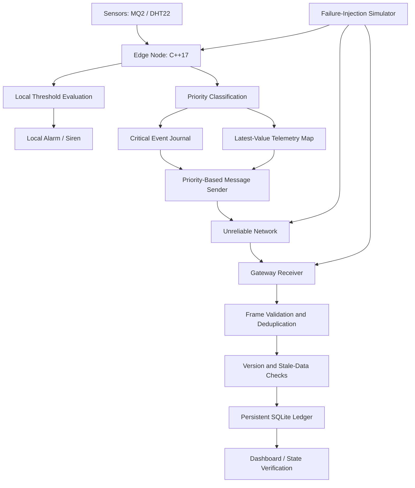

# LIFELINE
## Priority-First, Crash-Resilient Messaging for Offline IoT

**InnoHacks 2.0 · TechSpark 2026 · IoT Problem 5**

**Team Matrix**
- **B. Gangadhar** — Core Engine
- **K. Dinesh Kumar** — Gateway
- **R. Veera Poojitha** — Chaos Engine

---

## 1. Overview

LIFELINE is a fault-tolerant messaging framework designed for IoT systems that must continue operating when network connectivity becomes unreliable.

Conventional IoT applications often depend on continuous communication with a remote server or cloud platform. During network outages, devices may lose collected data, delay emergency notifications, replay previously received commands, or overwrite newer information with stale values.

These failures become especially serious in safety-sensitive environments, including rural monitoring systems, industrial facilities, healthcare environments, and disaster-response networks.

LIFELINE addresses these challenges through three principles:

1. **Act locally:** Critical monitoring and emergency responses continue without internet connectivity.
2. **Store and protect:** Critical events are recorded safely, prioritized, and protected against duplicate processing and stale updates.
3. **Synchronize and verify:** After connectivity returns, queued events are delivered in priority order and the recovered system state is checked against defined invariants.

The goal is to make IoT communication more predictable, recoverable, and trustworthy under network and process failures.

---

## 2. Problem Statement

IoT devices frequently operate in environments where network availability cannot be guaranteed. A device may lose connectivity because of weak signals, damaged infrastructure, power interruptions, or temporary network congestion.

Without appropriate fault-handling mechanisms, these conditions can cause:

- Loss of critical sensor events during an outage.
- Emergency notifications being delayed behind routine telemetry.
- Duplicate effects when previously transmitted commands are replayed.
- Older measurements overwriting newer dashboard values.
- Inconsistent state after a device or gateway restarts.
- Difficulty verifying whether the recovered system contains the correct data.

**LIFELINE's objective is to preserve critical event records, prioritize safety-related messages, prevent duplicate application effects, and reject stale updates during recovery.**

---

## 3. Project Objectives

- Continue local safety monitoring without internet connectivity.
- Store critical events in a crash-recoverable journal.
- Bound routine telemetry storage by retaining the latest value for each configured key.
- Prioritize critical alarms over routine messages.
- Detect corrupted records using CRC32.
- Track message sequences and versions to reject duplicate or stale updates.
- Support safe synchronization after network recovery.
- Validate behavior through repeatable failure-injection tests.
- Measure invariant violations under controlled failure schedules.

---

## 4. Three-Layer Trust Architecture

### Layer 1 — Act Locally

The edge node evaluates sensor readings locally and activates its alarm output when configured safety thresholds are exceeded.

For example, a gas-monitoring node can evaluate an MQ2 sensor and trigger a local siren without waiting for a cloud response. A DHT22 sensor can provide temperature and humidity measurements for monitoring.

The local safety path should remain independent of the remote messaging path.

**Key principle:** A network outage must not prevent a locally implemented emergency response.

> Sensor and hardware integration must be verified on the actual target device before claiming a working physical demonstration.

### Layer 2 — Store and Protect

LIFELINE separates critical events from routine telemetry.

**Critical events**
- Are recorded in an append-only journal.
- Include sequence or version metadata.
- Use CRC32 to detect record corruption.
- Are retained for delivery and recovery according to the journal's capacity and error-handling rules.

**Routine telemetry**
- Uses a latest-value slot for each configured key.
- Replaces older pending measurements with newer measurements for that key.
- Avoids unbounded accumulation of routine data.

If there are `K` configured telemetry keys, the latest-value map uses `O(K)` storage for the retained values, excluding key/value sizes and other system structures.

**Important distinction:** CRC32 detects accidental corruption; it does not by itself guarantee durable writes. Crash safety also depends on journal layout, commit ordering, storage behavior, and recovery logic.

### Layer 3 — Synchronize and Verify

When connectivity returns, the system resumes communication.

- Critical events receive priority over routine telemetry.
- Sequence metadata supports duplicate detection.
- Per-key versions prevent older measurements from replacing newer values.
- The gateway records accepted events and state changes in a persistent ledger.
- Tests evaluate whether the recovered state satisfies the required invariants.

For a production deployment, event acknowledgment, retry handling, gap detection, and persistent gateway updates must be coordinated to avoid losing events during interrupted synchronization.

---

## 5. System Architecture



### Main components

| Component | Responsibility |
|---|---|
| Edge node | Sensor evaluation, local response, and message creation |
| Priority manager | Selects critical events before routine messages |
| Journal | Stores critical records and supports recovery |
| Telemetry map | Retains the latest pending value for each key |
| Transport | Carries messages across an unreliable network |
| Gateway receiver | Validates messages and tracks duplicates |
| SQLite ledger | Persists received records and application state |
| Dashboard | Displays the latest recorded system state |
| Chaos engine | Injects failures to test recovery behavior |
| Invariant checker | Reports violations of the defined correctness rules |

The architecture describes the intended end-to-end system. Individual components should be labeled as implemented, tested, or planned according to the current repository.

---

## 6. End-to-End Workflow

### Step 1 — Normal operation

Sensors produce measurements. The edge node evaluates configured thresholds, updates routine telemetry, and creates critical events when necessary.

Routine telemetry is retained using the latest-value policy. Critical events follow the journal's persistence path.

### Step 2 — Network disconnection

The transport becomes unavailable.

The edge node continues local monitoring and emergency signaling. Critical records are retained according to the journal's capacity and commit behavior, while routine measurements can replace older pending values.

### Step 3 — Critical event occurs offline

Suppose a gas reading crosses its configured threshold.

1. The edge node detects the condition.
2. The local alarm activates.
3. A critical event is created.
4. The event is recorded before it is considered safely committed.
5. The event waits for transmission when the network becomes available.

The local alarm does not need to wait for remote acknowledgment.

### Step 4 — Network recovery

When communication resumes, the sender prioritizes critical events.

The gateway validates incoming frames, checks sequence metadata, rejects duplicates, and prevents stale measurements from replacing newer values.

The gateway persists accepted records and state changes in its ledger.

### Step 5 — Crash and restart recovery

The journal recovery procedure identifies valid records and rejects invalid or incomplete records according to its recovery rules.

The gateway reloads its persisted state from SQLite after a process restart.

These mechanisms must be tested independently: node recovery does not automatically prove gateway recovery, and vice versa.

### Step 6 — Verification

The simulator runs repeatable failure scenarios and evaluates the resulting state.

It checks for:

- Missing accepted critical events.
- Duplicate application effects.
- Stale telemetry overwrites.
- Violations of critical-message priority.
- Incorrect recovery after injected failures.

Each test run should record its seed, workload, failure schedule, and results.

---

## 7. Message Priority

LIFELINE uses three conceptual message classes.

| Priority | Message type | Handling policy |
|---|---|---|
| P0 | Critical alarms | Highest transmission priority |
| P1 | Control messages | Sent after critical events, according to the implementation's ordering rules |
| P2 | Routine telemetry | Latest pending value per key can replace older values |

This policy prevents a large backlog of routine measurements from automatically taking precedence over safety-related events.

Priority affects transmission order. It does not eliminate the need for adequate storage, retransmission, acknowledgments, and network recovery handling.

---

## 8. Crash Resilience and Data Integrity

### Append-only journal

Critical events are written to a journal before transmission. CRC32 is used to detect accidental corruption.

A robust journal implementation must define:

- Record format and length validation.
- Commit and acknowledgment semantics.
- Recovery from incomplete writes.
- Handling of invalid records.
- Behavior when storage becomes full.
- Safe recovery after interrupted compaction, if compaction is supported.

### Duplicate protection

Message sequence identifiers and persistent receiver state help prevent repeated messages from applying the same logical update multiple times.

Deduplication state must be retained for an appropriate period and must be updated consistently with the associated application state.

### Stale-data protection

Measurements include a version or ordering value for their respective keys.

The receiver accepts a measurement only when it is valid under the configured ordering rules. Older updates must not replace newer accepted state.

### Gateway persistence

A persistent ledger allows the gateway to restore accepted event history after a process restart.

For reliable application behavior, deduplication records and their corresponding state updates should be committed together in a database transaction.

---

## 9. Failure-Injection Testing

LIFELINE uses a deterministic simulator to test how the messaging core responds to unreliable conditions.

### Failure scenarios

- Network partitions.
- Packet loss.
- Duplicate delivery.
- Out-of-order delivery.
- Corrupted records or frames.
- Node crashes and restarts.
- Repeated execution using recorded random seeds.

### Invariants

**I1 — Critical-event preservation**

No accepted, committed critical event should be silently lost within the defined test model and its storage assumptions.

**I2 — Duplicate-effect prevention**

Replaying the same logical command must not cause a second application effect within the defined deduplication scope.

**I3 — Stale-update prevention**

An older measurement must not overwrite a newer accepted value for the same key.

**I4 — Priority correctness**

When critical events and lower-priority messages are pending, the sender must follow the defined critical-first scheduling policy.

The test report should include the number of runs, number of injected failures, invariant violations, and any assumptions that limit the results.

---

## 10. Empirical Evaluation

The following are the reported results from the project's simulator evaluation. They should be reproduced from the current code and recorded test output before being treated as final submission evidence.

| Metric | Modeled MQTT QoS 1 baseline | LIFELINE |
|---|---:|---:|
| Lost critical events | 1,161 | 0 reported violations |
| Duplicate application effects | 7,088 | 0 reported violations |
| Stale telemetry overwrites | 8,381 | 0 reported violations |

**Interpretation:** In the reported simulation, LIFELINE had zero violations of the three listed invariants, while the modeled baseline had violations.

These results do not establish that every real MQTT QoS 1 deployment will behave this way. MQTT QoS 1 permits duplicate delivery, and persistent sessions alone do not guarantee durable application storage, exactly-once physical actuation, or protection against stale application updates.

For a fair comparison, document the baseline configuration, storage assumptions, workload, and identical failure schedules. Distinguish simulator measurements from real-broker and hardware measurements.

Recommended additional metrics include:

- Critical-event delivery latency after reconnection.
- Recovery time after a node or gateway restart.
- Maximum journal capacity and storage overhead.
- Memory use as the number of telemetry keys increases.
- Number of injected crash points and recovery failures.

---

## 11. Technology Stack

| Layer | Technology |
|---|---|
| Core messaging engine | C++17 |
| Gateway | Python |
| Persistent gateway ledger | SQLite |
| Messaging transport | MQTT / Mosquitto integration |
| Failure testing | Deterministic simulator |
| Validation | Automated tests and invariant checks |
| Hardware demonstration | ESP32, if the target driver and hardware integration are implemented and tested |

The C++ core can be developed and tested independently of the physical device. This makes it possible to reproduce failures without relying exclusively on manual cable disconnections or power cycling.

---

## 12. Build and Run

### Prerequisites

- A C++ compiler supporting C++17.
- A terminal or command prompt.
- The source repository and its required project files.

### Compile the core simulator

From the repository root:

```bash
g++ -std=c++17 -O2 -Iinclude -I. src/*.cpp sim/*.cpp -o lifeline_sim
```

### Run the simulator

```bash
./lifeline_sim --seeds 200
```

On Windows, run the generated executable as:

```powershell
.\lifeline_sim.exe --seeds 200
```

Use the exact commands and test targets documented by the current repository. If a source file or simulator option differs in a particular revision, adjust the command accordingly.

### Run the automated tests

Follow the repository's documented test commands. Save the complete output, including failures, rather than recording only the final success count.

### MQTT gateway

If the Python gateway and Mosquitto integration are present in the checked-out revision, follow their dedicated setup instructions. A simulator-only build does not itself verify the end-to-end MQTT transport.

---

## 13. Project Structure

The core repository is organized around these conceptual areas:

```text
lifeline/
├── include/
│   └── lifeline/       # Public interfaces and data structures
├── src/                # Core messaging and persistence logic
├── sim/                # Deterministic failure simulator
├── tests/              # Automated validation
├── gateway/            # Python receiver and persistence (if included)
├── deploy/              # Broker and deployment configuration (if included)
└── README.md
```

The exact files and directories depend on the repository revision. Optional integration folders should not be shown as completed components unless they are actually present.

---

## 14. Limitations and Future Work

LIFELINE is intended to demonstrate fault-tolerant messaging principles, not to claim complete production readiness.

Current and potential limitations include:

- Fixed journal capacity and storage-exhaustion handling.
- Durability guarantees that depend on the target storage driver.
- Gateway transaction and crash-recovery behavior.
- Transport integration and reconnect testing.
- Persistent sequence and deduplication state management.
- ESP32 flash integration and physical sensor testing.
- MQTT authentication, access control, and secure transport.
- Testing at larger fleet sizes and under longer outages.

Future work includes crash-safe journal compaction, a complete edge-to-gateway MQTT integration, ESP32 flash drivers, real hardware fault injection, stronger recovery reporting, and security hardening.

---

## 15. Applications

Potential application areas include:

- Rural environmental monitoring.
- Gas-leak and industrial safety monitoring.
- Healthcare and facility monitoring.
- Agricultural sensing.
- Disaster-response sensor networks.
- Remote infrastructure monitoring.

Each application requires its own safety analysis, appropriate sensor calibration, and validation of local alarm behavior.

---

## 16. Conclusion

LIFELINE explores a priority-first, crash-resilient approach to messaging for disconnected IoT environments.

By combining local decision-making, bounded routine telemetry, durable critical-event recording, duplicate protection, stale-update checks, and deterministic failure testing, the project aims to keep system state trustworthy even when communication becomes unreliable.

Its central principle is simple:

**Safety should not wait for the network. Critical events should be preserved, delivered first, and verified after recovery.**

---

## Team Matrix

- **B. Gangadhar** — Core Engine
- **K. Dinesh Kumar** — Gateway
- **R. Veera Poojitha** — Chaos Engine

**Event:** InnoHacks 2.0 · TechSpark 2026  
**Track:** IoT · Problem 5
