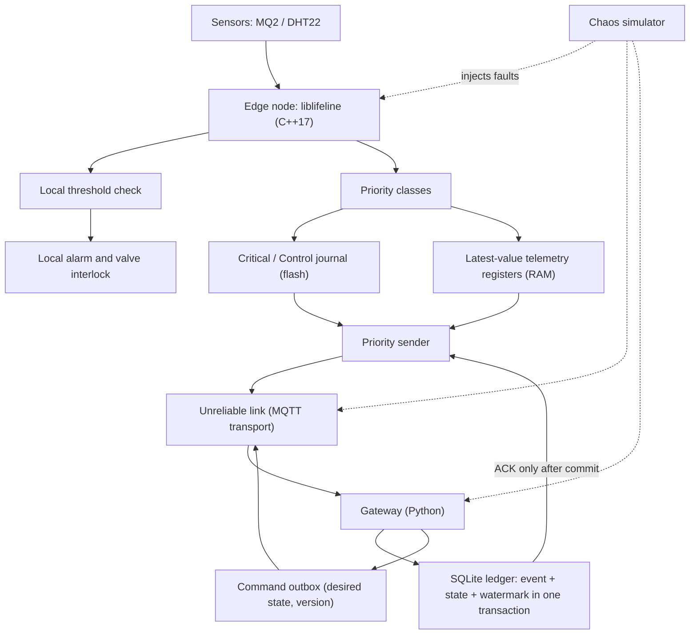
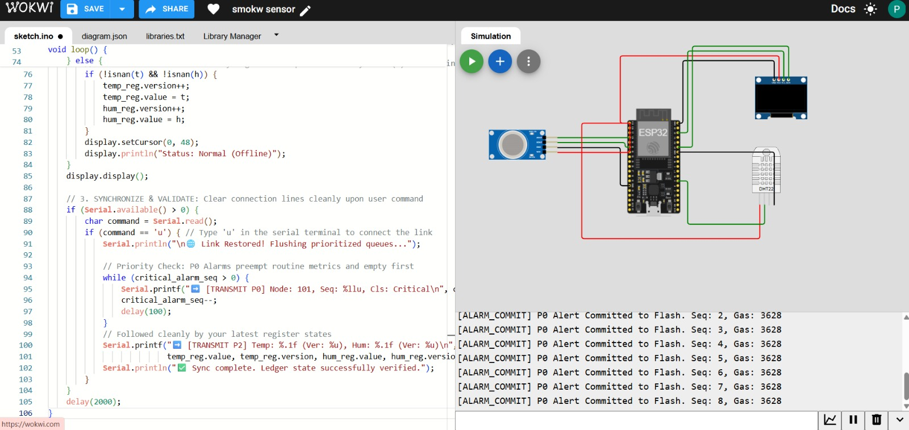
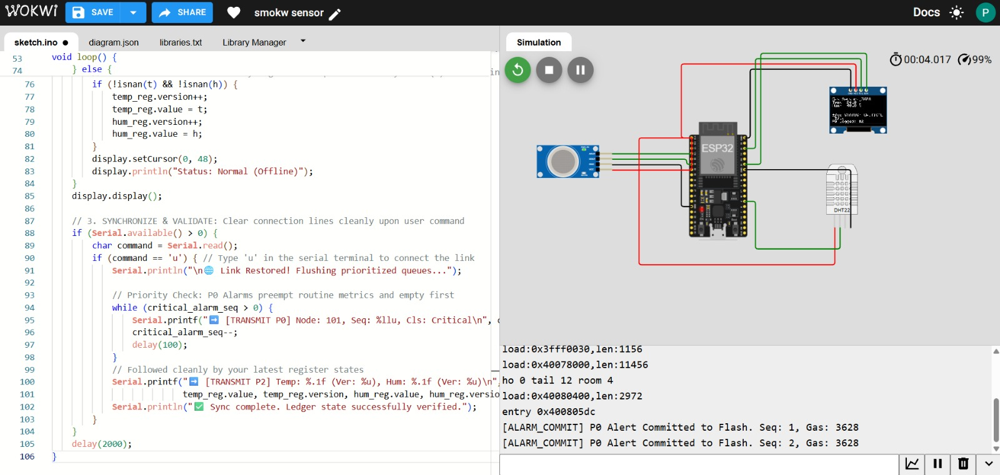
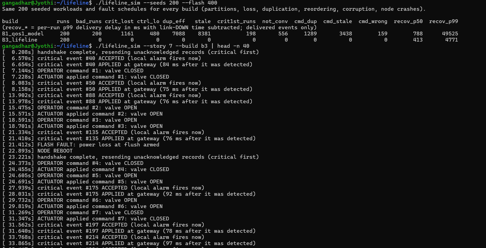

# LIFELINE

**Priority-first, crash-resilient messaging for offline IoT**


> When connectivity fails, local protection continues. When connectivity returns, critical events recover first,
> without silently losing accepted records, repeating application effects, or replacing newer decisions with older ones.

LIFELINE is a small, portable C++17 messaging core for IoT nodes, a Python + SQLite gateway, and a deterministic
failure simulator that checks the claims. Its differentiator is **reproducible evidence**, not a claim of perfect reliability.

---

## 1. The problem

The official problem statement names four failures of typical IoT systems:

1. Devices stop working or silently lose data when the network drops.
2. Critical alerts (for example a gas leak) get stuck behind routine messages.
3. Old commands replay after reconnection.
4. Stale information overwrites newer state.

## 2. What LIFELINE does

Three principles:

1. **Act locally.** The node reacts to a hazard on its own (alarm, valve interlock) without waiting for any network.
2. **Store and protect.** Critical events go into an append-only, CRC32-protected journal. The node reports whether
   each event was *durably accepted*, and keeps it until the gateway confirms it committed.
3. **Synchronize and verify.** After reconnecting, critical records go first. The gateway commits each event once,
   rejects older versions, and acknowledges only after its database commit. A simulator then checks the result.

| Failure | Mechanism |
|---|---|
| Data lost during an outage | Local response first, then a durable journal. `submit()` returns `Accepted`, `Full` or `IoError`, never a silent drop |
| Alert stuck behind routine traffic | Strict sender priority: Critical, then Control, then Telemetry. Telemetry keeps only the latest value per key, so a backlog cannot build up |
| Old commands replay | Commands are absolute desired states (`SET VALVE CLOSED`, never a toggle) with a `(term, seq)` version. The actuator persists the decision and rejects older versions. Duplicates are harmless |
| Stale data overwrites newer | Per-key `(epoch, version)` check at the gateway. A lower version never replaces a higher one |
| Duplicate effects after retry | Each record has a sequence number. The gateway inserts it, updates state and advances its watermark in **one SQLite transaction**, then acknowledges. A repeat is acknowledged again but not re-applied |

A record is **durably accepted** only when the storage write and sync both succeeded. An event cut off by a power
failure before that point is reported as not accepted, and LIFELINE makes no claim about it.

## 3. Architecture



**Delivery protocol**

1. After every (re)connect the node sends `HELLO`; the gateway answers `WELCOME` with its committed watermarks.
2. The node resends everything above the watermark, critical first.
3. The gateway commits, then sends `ACK(cumulative)`. The node drops records only after that ACK.
4. If an ACK is lost, the node resynchronises and the watermark tells it what is already committed.

| Frame | Direction | Purpose |
|---|---|---|
| `Data` | node → gateway | One critical, control or telemetry record |
| `Hello` / `Welcome` | node ⇄ gateway | Resynchronisation after reconnect |
| `Ack` / `TeleAck` | gateway → node | Cumulative commit acknowledgment / newest applied telemetry version |
| `Cmd` / `CmdAck` | gateway ⇄ actuator | Desired-state command / commit or stale rejection |

Every frame is `[type][body][CRC32]`; a corrupt frame is dropped and retried.

**MQTT.** MQTT QoS 1 acknowledges one hop, from client to broker. LIFELINE waits for its own acknowledgment after the
*application's* durable commit, and adds priority, versions and a durable device queue on top. It does not replace MQTT.

## 4. Guarantees, assumptions and limits

**Invariants checked by the simulator**

| ID | Invariant |
|---|---|
| I1 | A durably accepted critical record is never silently lost: it is committed at the gateway or still recoverable at the node |
| I2 | Repeated delivery of one event identifier does not apply its effect twice |
| I3 | A lower version never replaces a higher committed version for the same key or command stream |
| I4 | When the sender picks its next record, pending critical traffic is chosen before routine telemetry |

Resources are bounded: when the journal is full the enqueue call returns an explicit failure, the local alarm still
works, and records that were already accepted are never discarded.

**Assumptions.** Committed storage stays intact, node identities and sequence numbers are not reset (a replaced device
must be re-enrolled), connectivity eventually returns, each sensor key has one writer, the gateway is the only command
authority for an actuator, and messages are not forged.

**Not attempted.** Multi-hop mesh routing, general multi-writer merging, malicious-node tolerance, authentication,
exactly-once *physical* actuator movement, unlimited retention during unlimited outages, validated flash-endurance
behaviour. This is a software demonstration, **not a certified safety system.**

## 5. Status

| Component | Status | How it is verified |
|---|---|---|
| C++17 core: journal, sequences, priority, bounded queues, version checks, actuator | Implemented | Unit tests in `tests/`, including crash-at-every-byte and randomized crash runs |
| Deterministic chaos simulator (`sim/`) | Implemented | `./lifeline_sim --seeds 200` |
| Python + SQLite gateway (`gateway/`) | Implemented as a library | Cross-checked against the C++ node and actuator over the real frame format |
| ESP32 sketch on LittleFS (`wokwi/`) | Implemented | Logic checked on a PC with `host_test/`; **simulation only** |
| MQTT / Mosquitto adapter | Planned | Not in this revision |
| Crash-safe journal compaction | Planned | The journal is fixed-capacity |
| Real ESP32 hardware and real-flash power-loss tests | Not done | |

## 6. Quick start

Requirements: a C++17 compiler and Python 3.8+. There are no other dependencies.

**Unit tests**

```bash
mkdir -p build
g++ -std=c++17 -O1 -Iinclude -Ithird_party -Itests \
    src/codec.cpp src/journal.cpp src/node.cpp src/messages.cpp src/actuator.cpp tests/*.cpp -o build/tests
./build/tests
```

**Chaos simulator**

```bash
g++ -std=c++17 -O2 -Iinclude -I. src/*.cpp sim/*.cpp -o lifeline_sim
./lifeline_sim --seeds 200          # Windows: .\lifeline_sim.exe --seeds 200
```

Keep the complete output, including any failing seeds, in `results/`.

**Gateway**

```python
from gateway.gateway import Gateway, open_db

gw = Gateway(open_db("lifeline.db"))      # WAL mode, synchronous=FULL
replies = gw.on_frame(frame_bytes)        # -> [(node_id, reply_frame), ...]
cmd = gw.issue_command(actuator=3, desired=1)   # persisted before it is ever sent
```

A gateway restart is simply a new `Gateway` on the same database file.

## 7. ESP32 demo in Wokwi (simulation)

`wokwi/` holds an ESP32 sketch (MQ2 gas sensor, DHT22, SSD1306 OLED, buzzer, valve LED) that runs the **real core**
with its journal stored in LittleFS. Setup and the full command list are in [`wokwi/README_WOKWI.md`](wokwi/README_WOKWI.md).

| Key | Shows |
|---|---|
| `g` | Gas event: local alarm first, then `ACCEPTED seq=N` after the durable write |
| `d` / `u` | Link down / up: HELLO/WELCOME, then critical records flush before telemetry |
| `r` | Reboot: pending records survive and sequence numbers continue |
| `x` | Modeled power loss mid-write: not accepted, torn bytes cut on boot, no sequence reuse |
| `p` / `s` / `k` | Replayed duplicate, stale telemetry and old command are all rejected |
| `l` | Lost ACK: no duplicate effect |




**What this demo is, exactly:** a Wokwi simulation of the LIFELINE core on an ESP32 with LittleFS. The power loss is a
fault injected in software, and the gateway inside the sketch is a stand-in. The full protocol is verified separately
by the unit tests and the simulator. It is not a test on physical hardware.

## 8. Results (reported)

Reported by the project's simulator over 200 seeds, under identical multi-fault timelines:

| Metric | Modeled MQTT QoS 1 baseline | LIFELINE |
|---|---:|---:|
| Lost critical events (I1) | 1,161 | 0 violations |
| Duplicate application effects (I2) | 7,088 | 0 violations |
| Stale telemetry overwrites (I3) | 8,381 | 0 violations |

Read these figures carefully:

- They come from a **simulated, modeled baseline** (MQTT QoS 1, stable client id, persistent session, RAM-only
  application queue). They do not show that every real MQTT deployment behaves this way.
- "0 violations" holds only for the faults the simulator injects, within the assumptions in section 4.
- Reproduce them from the current commit and store the output in `results/` with: commit hash, seed range,
  configuration, per-run violation counts, any failing seeds, and how many runs completed within their deadline.
- Simulator numbers, real-broker numbers and hardware numbers must be reported separately.

## 9. What each kind of evidence supports

| Evidence | Supports |
|---|---|
| Unit tests | Specific mechanisms and boundary cases |
| Chaos simulator | Recovery behaviour under the modeled faults |
| `host_test/` on the Wokwi sketch | The sketch logic, not Wokwi or the ESP32 toolchain |
| Wokwi demo | Firmware integration and local reaction, in simulation |
| Real broker and hardware tests (future) | Real MQTT behaviour, real flash, power and radio |

## 10. Repository layout

```
include/lifeline/   public interfaces: protocol, journal, node, messages, dedup, actuator
src/                core implementation
sim/                deterministic chaos simulator
tests/              unit tests (doctest in third_party/)
gateway/            Python + SQLite gateway and frame codec (wire.py)
wokwi/              ESP32 sketch, flat copy of the core, LittleFS adapter, diagram.json
host_test/          runs the sketch logic on a PC against stand-ins for Arduino and LittleFS
docs/               screenshots
results/            saved simulator output
```

## 11. Limitations and future work

- The journal has fixed capacity and does not reclaim space yet. Crash-safe compaction is the main storage task.
- Durability depends on the target flash driver. The simulator's storage model does not validate a particular ESP32 filesystem.
- A failed flush is reported as `IoError`. The journal removes any bytes that survived, so a sequence number is never reused.
- Telemetry is a latest-value snapshot, not a lossless history.
- No authentication or encryption; use isolated demonstration data only.
- Next: MQTT adapter with a real broker, ESP32 flash driver tests, hardware power-cut tests, and larger fleets.

## 12. References

- Official InnoHacks 2.0 problem statements, IoT Problem 5.
- OASIS MQTT v5.0 specification: <https://docs.oasis-open.org/mqtt/mqtt/v5.0/mqtt-v5.0.html>
- SQLite atomic commit: <https://www.sqlite.org/atomiccommit.html>
- SQLite write-ahead logging: <https://www.sqlite.org/wal.html>
- SQLite pragmas (`synchronous`): <https://www.sqlite.org/pragma.html>

---

**Safety should not wait for the network. Critical events should be preserved, delivered first, and verified after recovery.**
